<p align="center">
  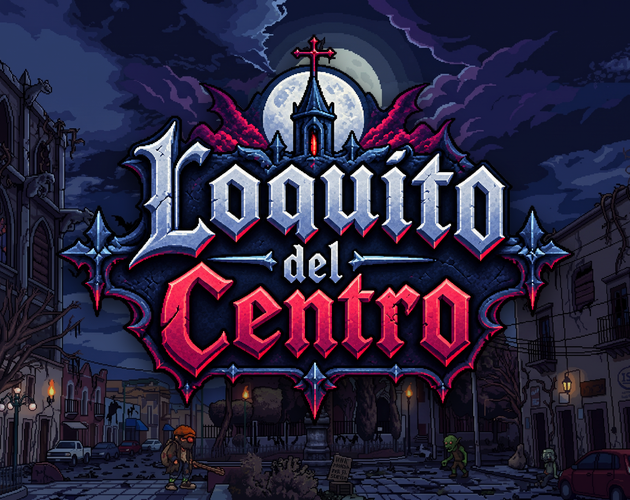
</p>

<h3 align="center">De Sanfe para el mundo</h3>

<p align="center">
  Plataformero 2D de acción en pixel art, inspirado en los clásicos góticos tipo <i>Castlevania</i>.<br>
  Hecho en Unity 6 · Se juega en el navegador en <a href="https://pedrourielperezmonzon.itch.io/loquitodelcentro">itch.io</a>
</p>

---

## Contenido

- [Historia](#historia)
- [Cómo jugar](#cómo-jugar)
- [Niveles](#niveles)
- [Personajes](#personajes)
- [Jefes](#jefes)
- [Objetos](#objetos)
- [Menú, configuración y sonido](#menú-configuración-y-sonido)
- [Capturas](#capturas)
- [Para desarrolladores](#para-desarrolladores)
- [Publicar en itch.io](#publicar-en-itchio)
- [Créditos](#créditos)

---

## Historia

Unas **antenas 5G** que puso **La Señora** tienen a San Felipe bajo su señal. El **Loquito**, un vagabundo del centro,
despierta en el jardín, recibe de **Martha la Loca** lo necesario para defenderse y baja a los templos a **derribar
cada antena**. En cada templo lo espera un jefe que la protege.

Si además encuentra los **4 coleccionables** escondidos en cuartos secretos, desbloquea el **final secreto**:
el Loquito por fin descansa en su trono, con sus frijoles y su coca fría.

---

## Cómo jugar

### Controles

| Acción | Teclado | Control |
|---|---|---|
| Moverse | `A` / `D` o flechas | Stick izquierdo / cruceta |
| Saltar (y doble salto) | `Espacio` | `A` / `Cruz` |
| Atacar con la botella | `J` | `X` / `Cuadrado` |
| Cubrirse con el cartón (mantener) | `K` | Gatillo derecho |
| Interactuar (hablar, antena, puerta) | `E` | `Y` / `Triángulo` |
| Configuración / pausa | `Esc` o `Tab` | `Start` |

> En el navegador, `Esc` también sale de la pantalla completa; por eso `Tab` abre la configuración igual.

### Mecánicas

- **Vida en panalitos:** el Loquito tiene **5 panalitos**. Cada golpe quita uno; los panalitos tirados en el mapa
  devuelven uno.
- **Checkpoints:** la cama de cartón con fogata guarda el punto de reaparición. Si pierdes todos los panalitos
  vuelves ahí con la vida completa.
- **Botella de chela rota:** combo de **tres golpes** (el tercero empuja al enemigo) y **patada aérea** si atacas
  en el aire.
- **Cartón:** se mantiene para bloquear golpes y proyectiles de frente. Mientras te cubres caminas a la mitad de
  velocidad. **Aguanta 3 golpes** y se recupera solo después de **8 segundos**.
- **Calcetas del Verde:** permiten el **doble salto**. Se recarga al tocar el suelo.
- **Muros falsos:** algunas paredes se rompen de un botellazo y esconden un **cuarto secreto** con un coleccionable.
- **Sala del jefe:** al entrar, la compuerta se cierra y no hay escapatoria. Si mueres, la compuerta se abre y la
  pelea se reinicia.
- **Antena:** después de vencer al jefe, interactúa con la antena para derribarla. Luego la **puerta de salida**
  te lleva al siguiente nivel.
- En la Mazmorra 2 y la Mazmorra 3 los enemigos **reaparecen** cuando el jugador muere.

---

## Niveles

| # | Nivel | Qué pasa |
|---|---|---|
| 0 | **El Jardín** | Tutorial. Carteles que enseñan cada control y Martha la Loca, que te da el cartón, la botella y las calcetas. |
| 1 | **Templo del Reloj** | Primera mazmorra. Jefe: **El Campanero del Reloj**. |
| 2 | **Templo del Pozo** | Plataformas que se atraviesan desde abajo. Jefe: **El Dragón Borracho**. |
| 3 | **Templo de la Campana Rota** | Mapa más grande. Jefa final: **La Señora**. |

Al derribar la última antena aparece la pantalla de victoria (o el final secreto si tienes los 4 coleccionables).

---

## Personajes

| | Personaje | Descripción |
|:---:|---|---|
| 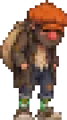 | **El Loquito** | El protagonista. Pelea con una botella rota y se cubre con un cartón. |
| 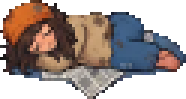 | **Martha la Loca** | Ronca en el jardín. Si le hablas (`E`), platica contigo y te entrega el cartón, la botella y las calcetas. |
| 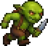 | **Duende** | Corre de un lado a otro y salta de repente. |
| 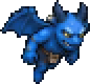 | **Esbirro alado** | Vuela patrullando y te lanza bolas de chocolate. Se le alcanza saltando. |
| 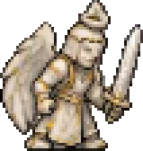 | **Ángel blanco** | Estatua inmortal. Si te acercas suelta un espadazo; después de atacar puedes pasar sin que te dañe. |

## Jefes

| | Jefe | Ataques |
|:---:|---|---|
| 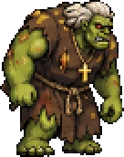 | **El Campanero del Reloj**<br>Mazmorra 1 | Lejos: lanza su **chancla** directo a ti. Cerca: **golpe de garrote** doble. Antes de cada ataque brilla y tiembla para avisarte. Después de varios ataques **se cansa** y se queda quieto unos segundos: es el momento de pegarle. |
| 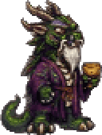 | **El Dragón Borracho**<br>Mazmorra 2 | Lejos: se da unos **tragos de su copa** y luego se contonea lanzando **3 bolas de fuego**, o suelta un **ave** que te persigue 3 segundos. Cerca: **rasguño** o **embestida**, y los dos terminan en una **onda expansiva** por el suelo. |
| 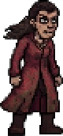 | **La Señora**<br>Mazmorra 3 | Si saltas cerca o estás arriba de ella: **patada giratoria**. Cerca y al mismo nivel: **golpe con onda expansiva** o **embestida**. Lejos: lanza **dos aves**, una por cada lado, que te persiguen. Descansa un momento entre ataques. Tiene 20 puntos de vida. |

---

## Objetos

**Objetos que te da Martha**

| 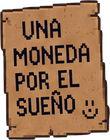 | 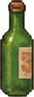 | 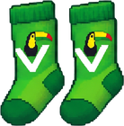 |
|:---:|:---:|:---:|
| **Cartón**<br>Bloqueo frontal | **Botella de chela**<br>Arma (combo de 3 golpes) | **Calcetas del Verde**<br>Doble salto |

**Coleccionables** (uno escondido en cada nivel; con los 4 se ve el final secreto)

| 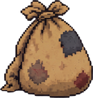 | 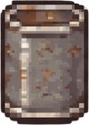 | 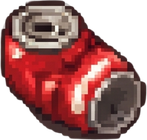 | 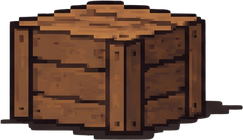 |
|:---:|:---:|:---:|:---:|
| **Bolsa de vagabundo**<br>El Jardín | **Lata de frijoles**<br>Mazmorra 1 | **Lata de coca**<br>Mazmorra 2 | **Cajita de madera**<br>Mazmorra 3 |

**En el mapa**

| 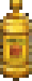 | 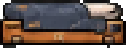 | 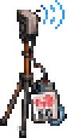 |
|:---:|:---:|:---:|
| **Panalito**<br>Recupera una vida | **Checkpoint**<br>Punto de reaparición | **Antena 5G**<br>Derríbala para terminar el nivel |

---

## Menú, configuración y sonido

- **Menú principal:** Jugar, Créditos y Salir (en la versión web no hay Salir, porque el navegador no deja cerrar
  el juego).
- **Configuración** (engrane de la esquina superior derecha, `Esc`, `Tab` o `Start`):
  - botón de **silencio**;
  - barras de volumen de **Música** y **Efectos**;
  - Jugar, Créditos y Salir.
  - Dentro de un nivel **pausa el juego**: Jugar reanuda y Salir regresa al menú principal.
- **Música:** cada nivel y cada jefe tienen su canción. Al vencer a un jefe todo queda en silencio.
- **Efectos:** saltos, golpes, bloqueo con el cartón, objetos recogidos, ataques de enemigos y jefes, y la voz
  ("balbuceo") de los diálogos.
- **Se guarda aunque cierres el juego:** volúmenes, silencio y si ya viste el final secreto. Después del final
  secreto aparece en el menú una opción para elegir la canción del menú.

---

## Capturas

| | |
|:---:|:---:|
| 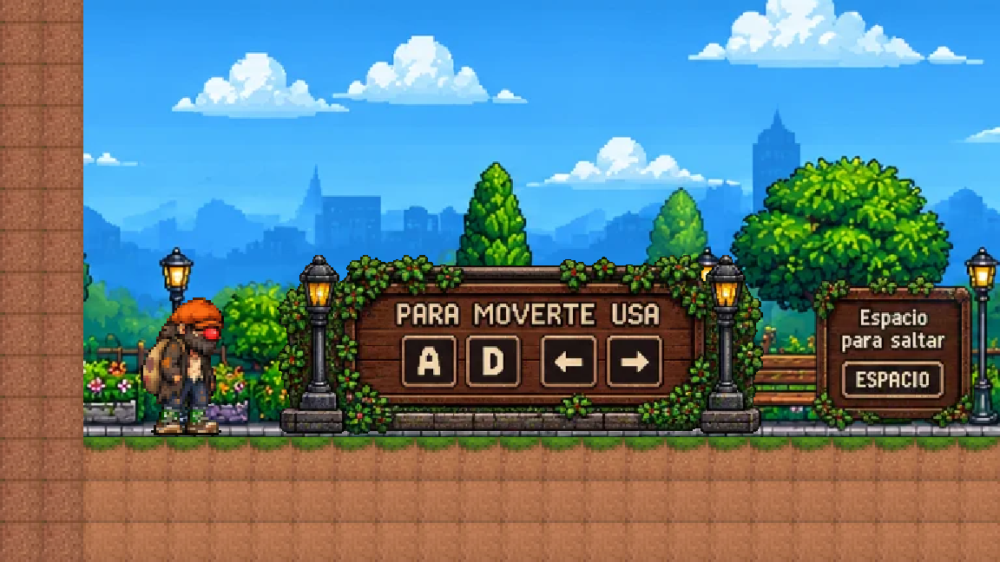<br>El Jardín | 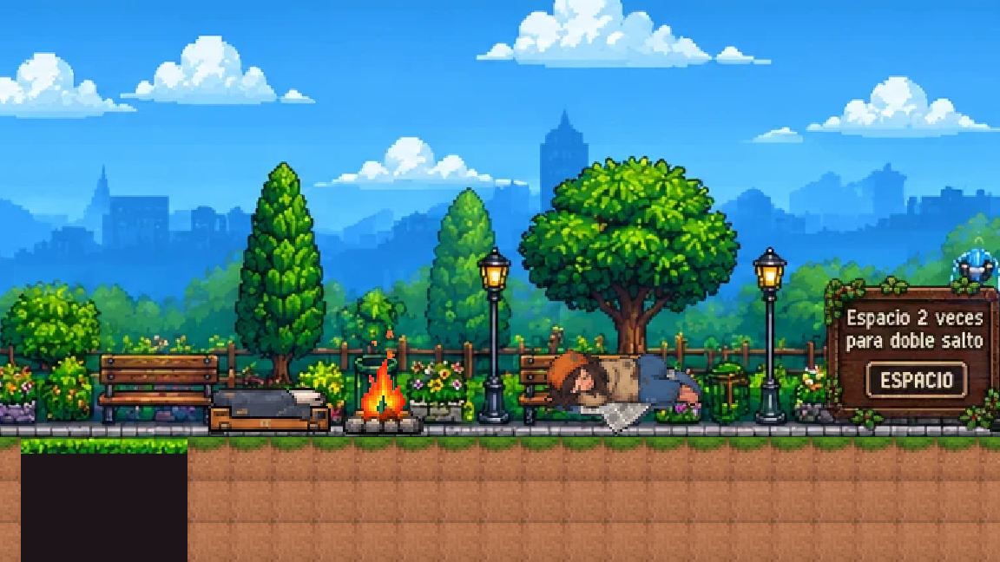<br>Martha la Loca |
| 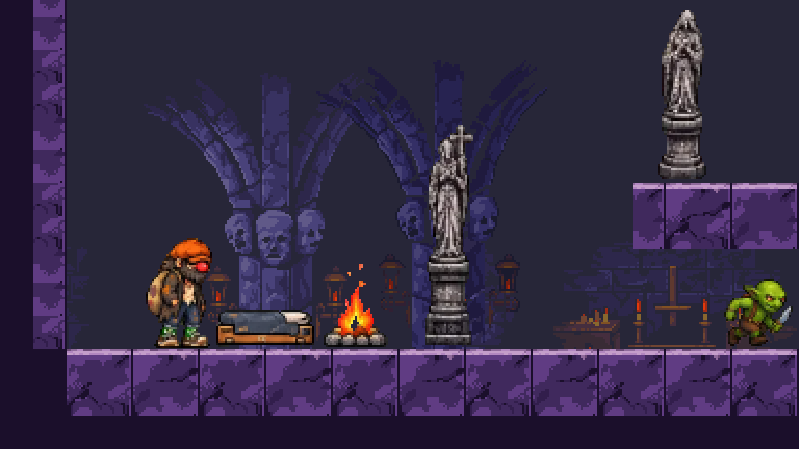<br>Mazmorra 1 | 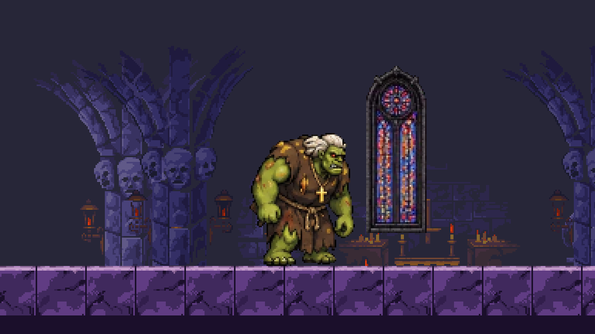<br>Sala del Campanero |
| 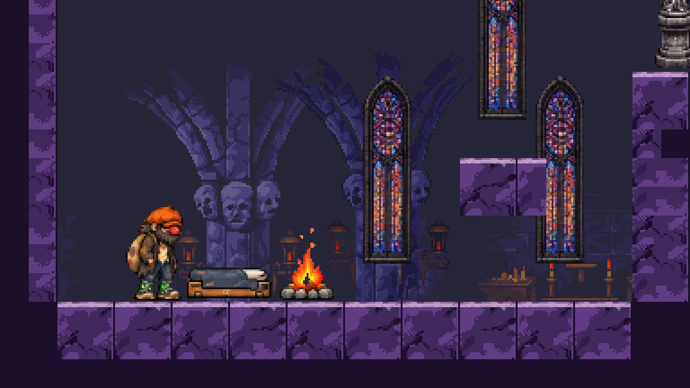<br>Mazmorra 2 | 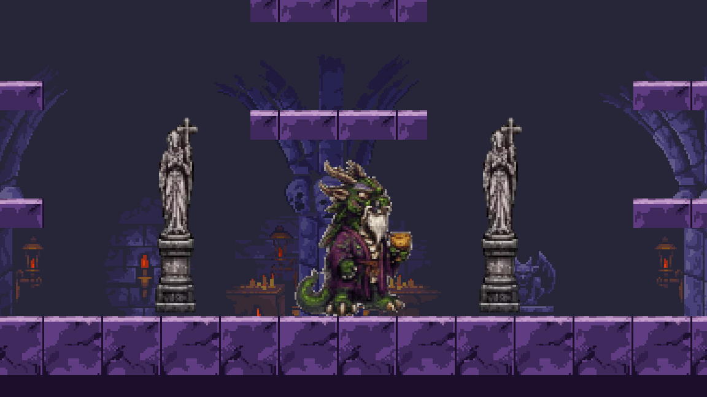<br>Sala del Dragón Borracho |
| 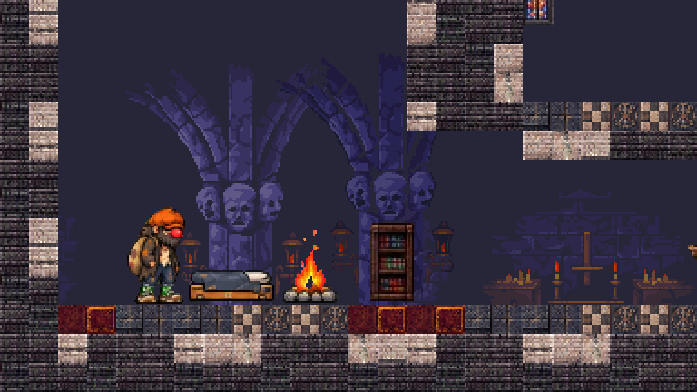<br>Mazmorra 3 | 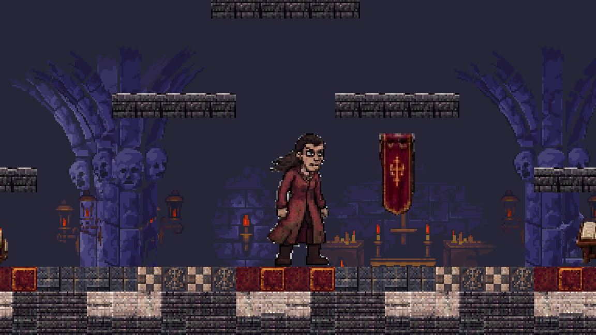<br>Sala de La Señora |

---

## Para desarrolladores

### Requisitos

- **Unity 6000.3.24f1** (Unity 6) con el módulo **WebGL Build Support** (para publicar en itch.io).
- Paquetes principales (se instalan solos al abrir el proyecto): Universal Render Pipeline 2D, Input System,
  Tilemap.
- Python 3 con Pillow, solo si se quieren volver a exportar sprites desde `SpritesOriginales/`.

### Abrir el proyecto

1. Clonar el repositorio o hacer `git pull` en `main` para traer los últimos cambios.
2. En **Unity Hub** → **Add** → elegir la carpeta del proyecto y abrirlo con la versión 6000.3.24f1.
3. La primera vez tarda en importar. Abrir la escena `Assets/Scenes/Inicio.unity` y darle **Play**.

> **Antes de empezar a trabajar, siempre `git pull`.** Así no se pisan los cambios del otro.

### Estructura

```
Assets/
  Editor/        Herramientas del editor: constructor de niveles, build web, capturas del README
  Levels/        Mapas de los niveles en texto (Jardin.txt, Mazmorra1.txt, ...)
  Prefabs/       Loquito, enemigos, jefes, objetos
  Resources/     Audio (Musica/ y SFX/) y menú; se cargan por nombre desde el código
  Scenes/        Inicio, Jardin, Mazmorra1-3, Victoria
  Scripts/
    Audio/       AudioManager: música y efectos de todo el juego
    Core/        GameManager: orden de niveles, coleccionables y habilidades
    Enemigos/    Enemigos, proyectiles, aves y ondas expansivas
    Jefe/        Arena del jefe y cada jefe (Campanero, Dragón, La Señora)
    Jugador/     Combate, vida y controles del Loquito
    NPC/         Martha la Loca
    Objetos/     Antena, checkpoint, coleccionables, panalitos, muros falsos, salida
    UI/          HUD, menú principal, configuración, pantalla de victoria
  Sprites/       Sprites del juego (Propios/ = arte propio, GothicVania/ = recursos externos)
SpritesOriginales/   Hojas de sprites originales y scripts de Python que las recortan
docs/img/            Imágenes de este README
```

### Cómo se construyen los niveles

Los niveles se dibujan como **texto** en `Assets/Levels/*.txt` (cada carácter es una casilla) y el menú
**Loquito → Construir todo** genera las escenas a partir de ellos. Para cambiar un nivel: editar su `.txt` y volver
a construir.

| Carácter | Significado | Carácter | Significado |
|:---:|---|:---:|---|
| `#` | Bloque sólido | `B` | Muro falso (se rompe con la botella) |
| `P` | Inicio del jugador | `C` | Checkpoint |
| `H` | Panalito | `V` | Panalito que reaparece |
| `K` | Coleccionable del nivel | `X` | Puerta de salida |
| `D` | Duende | `Q` | Duende quieto (jardín) |
| `E` | Esbirro alado | `A` | Ángel blanco |
| `G` | Compuerta del jefe | `J` | Jefe |
| `[` `]` | Esquinas de la arena del jefe | `N` | Antena |
| `M` | Martha la Loca | `T` | Plataforma atravesable desde abajo |
| `1`–`6` | Carteles del jardín | | |

> Construir regenera las escenas: los cambios hechos a mano dentro de una escena generada se pierden.
> Lo que deba quedarse, mejor ponerlo en el `.txt` o en el constructor (`Assets/Editor/LoquitoLevelBuilder.cs`).

### Menú *Loquito* del editor

| Opción | Qué hace |
|---|---|
| **Construir todo** | Regenera todas las escenas, prefabs y configuración de sprites y audio |
| **Construir solo mazmorras** / **Mazmorra 2** / **Mazmorra 3** | Regenera solo esas escenas |
| **Build web (itch)** | Hace el build WebGL y el ZIP para subir a itch.io |
| **Capturas para el README** | Toma las capturas de `docs/img/capturas` |

### Sonido

Los audios van en `Assets/Resources/Audio/Musica` y `Assets/Resources/Audio/SFX`, y el código los toca por nombre
(por ejemplo `AudioManager.Instance.PlaySfx("Salto")`). Para agregar un sonido: copiar el archivo a la carpeta y
llamarlo por su nombre sin extensión.

---

## Publicar en itch.io

1. En Unity: menú **Loquito → Build web (itch)**. Tarda varios minutos; al terminar abre la carpeta con el ZIP
   (`Builds/itch/LoquitoDelCentro_web.zip`).
2. En itch.io: **Edit game** → **Uploads** → **Upload files** → elegir el ZIP.
3. Marcar **"This file will be played in the browser"** en el archivo nuevo y borrar el ZIP anterior
   (**Delete file**).
4. **Save**.

Configuración que ya tiene el proyecto: WebGL con compresión **Gzip** (con *Decompression Fallback*) y canvas de
**960 × 540**. En itch, **Embed options**: viewport de 960 × 540 con **Fullscreen button**.

También se puede hacer el build sin abrir Unity (con Unity cerrado):

```bash
"C:/Program Files/Unity/Hub/Editor/6000.3.24f1/Editor/Unity.exe" -batchmode -quit -projectPath . -executeMethod WebBuild.BuildBatch -logFile Builds/build_web.log
```

---

## Créditos

**Alumnos**
- Pedro Uriel Pérez Monzón
- Miguel Ángel Álvarez Ibarra

**Universidad Tecnológica del Norte de Guanajuato**
Ingeniería en Desarrollo y Gestión de Software · Creación de Videojuegos · Profesor: Gabriel Barrón Rodríguez

**Recursos externos**
- [GothicVania Church Pack](https://ansimuz.itch.io/gothicvania-church-pack) · Luis Zuno (ansimuz)

Hecho con Unity 6.
